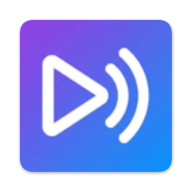

<div align="center">



# دوبله پارسی — Doble Parsi V1.0.0

**دوبلهٔ زندهٔ هر صدایی که روی گوشی پخش می‌شود، با هوش مصنوعی + خروجی صوتی و زیرنویس**
_AI live dubbing for any audio playing on your Android phone, with audio and subtitle output_

Android 10+ (API 29) · Kotlin + Jetpack Compose · فارسی / English

پورت اندرویدی افزونهٔ کروم **دوبله پارسی** — ساخته‌شده توسط **[QW-AI-Code](https://github.com/QW-AI-Code)**

[دانلود APK از ریلیزها / Download the APK](../../releases/latest)

</div>

---

<div dir="rtl">

## فارسی

### چه می‌کند
افزونهٔ کروم فقط صدای تب مرورگر را می‌گرفت و روی موبایل کار نمی‌کرد. این اپ همان
موتور دوبله را با APIهای بومی اندروید اجرا می‌کند: صدای **هر اپی** که روی گوشی پخش
می‌شود (یوتیوب، تلگرام، اینستاگرام، مرورگر، پادکست، هر پلیری) را با
`MediaProjection` می‌گیرد، به `gemini-3.5-live-translate-preview` می‌فرستد و همان
لحظه دوبله را پخش می‌کند. مدل خودش **صدای گویندهٔ اصلی را تقلید می‌کند**؛ هیچ
«انتخاب صدا»یی لازم نیست.

در پایان هر جلسه، خروجی‌ها **هم‌نام خودِ ویدئو** ذخیره می‌شوند:

```
Download/Doble Parsi/<نام ویدئو>/
├── <نام ویدئو>.m4a            صدای دوبله (یا میکس دوبله و صدای اصلی)
├── <نام ویدئو>.srt            زیرنویس دوبله
└── <نام ویدئو>.original.srt   زیرنویس زبان مبدأ (اختیاری)
```

### نصب
۱. از بخش **[Releases](../../releases/latest)** فایل APK را بگیر. **یک فایل** هست:

| فایل | برای چه گوشی‌ای |
|---|---|
| `DobleParsi-1.0.0-universal.apk` | همهٔ گوشی‌های اندروید ۱۰ و بالاتر (هر معماری: arm64-v8a، armeabi-v7a، x86_64) |

> **چرا دیگر سه فایل نیست؟** در ریلیزهای قبلی هر سه APK دقیقاً ۴۱٫۸ مگابایت بودند.
> دلیلش باگ نبود، بی‌فایده بودن تفکیک ABI بود: این اپ **هیچ کتابخانهٔ بومی (`.so`)**
> ندارد (کاتلین + Compose + OkHttp و انکودر AAC خودِ اندروید). تفکیک ABI فقط پوشهٔ
> `lib/<abi>` را جدا می‌کند و وقتی چیزی برای جدا کردن نیست، هر سه فایل کپی بایت‌به‌بایت
> نسخهٔ یونیورسال می‌شوند. حالا یک APK یونیورسال ساخته می‌شود که روی همه نصب است، و
> در عوض حجم واقعی با **R8 + حذف منابع بی‌استفاده** کم شده است.

۲. در گوشی، «نصب از منابع نامشخص» را برای فایل‌منیجر یا مرورگرت روشن کن و APK را نصب کن.
۳. صحت فایل را می‌توانی با `SHA256SUMS.txt` همان ریلیز بررسی کنی.

### آموزش گام‌به‌گام
۱. اپ را باز کن.
۲. کلید API جِمینای را از [Google AI Studio](https://aistudio.google.com/apikey) بگیر و در کادر **کلید API جِمینای** بگذار. کلید فقط در حافظهٔ خصوصی همین اپ ذخیره می‌شود.
۳. **زبان دوبله** را انتخاب کن (پیش‌فرض: فارسی). ۳۱ زبان در فهرست است.
۴. کلیدهای بخش «خروجی‌ها و پخش» را تنظیم کن: پخش زندهٔ دوبله، کم‌کردن صدای اصلی، ذخیرهٔ صوت، ذخیرهٔ زیرنویس، زیرنویس زبان اصلی، دکمهٔ شناور.
۵. **شروع دوبله** را بزن. اندروید سه چیز می‌پرسد (فقط بار اول): اجازهٔ **میکروفون**، اجازهٔ **ضبط صدا/تصویر دستگاه** («Start now» را بزن) و اگر دکمهٔ شناور روشن است، اجازهٔ **نمایش روی برنامه‌های دیگر**.
۶. برو داخل یوتیوب/تلگرام/مرورگر و ویدئو را پخش کن. دوبله همان لحظه شنیده می‌شود.
۷. برای پایان: دکمهٔ شناور را لمس کن، یا از اعلان **پایان** را بزن، یا به اپ برگرد و **پایان دوبله** را بزن. دکمهٔ شناور بعد از پایان سرِ جایش می‌ماند؛ برای ویدئوی بعدی همان را بزن.
۸. اعلانِ «خروجی‌های دوبله ذخیره شد» فهرست فایل‌ها را نشان می‌دهد؛ فایل‌ها در `Download/Doble Parsi/<نام ویدئو>/` هستند.

> **برای این‌که فایل‌ها هم‌نام ویدئو ذخیره شوند**، یک بار دسترسی **«اعلان‌ها»** را
> برای دوبله پارسی روشن کن (اپ خودش با یک کارت پیشنهاد می‌دهد و مستقیم به همان
> صفحهٔ تنظیمات می‌برد). اندروید نام ویدئوی درحال‌پخش را فقط از طریق
> `MediaSession` می‌دهد و خواندن آن به این دسترسی نیاز دارد. اگر روشن نباشد، نام
> فایل «نام اپ پخش‌کننده + تاریخ و ساعت» می‌شود.

### دکمهٔ شناور (نسخهٔ بازنویسی‌شده)
دکمهٔ شناور دیگر فقط «دکمهٔ پایان» نیست؛ کنترل کامل جلسه است:

- **ظاهر حرفه‌ای**: بدنهٔ شیشه‌ای تیره، حلقهٔ گرادیان برند که در طول جلسه می‌چرخد، و
  کمان ثانیه‌شمار دور دکمه.
- **اکشن «یک نفر دارد حرف می‌زند»**: هنگام دوبله، پنج میله داخل دکمه با **بلندی
  واقعی صدای دوبله** بالا و پایین می‌روند (سطح صدا از خود پخش‌کنندهٔ دوبله خوانده
  می‌شود)، به‌علاوهٔ هالهٔ نبض‌دار پیرامون دکمه. هنگام اتصال، سه نقطهٔ نبض‌دار و هنگام
  ذخیره، اسپینر نشان داده می‌شود.
- **تایمر دوبله روی دکمه**: زمان ضبط (`دقیقه:ثانیه`) داخل خودِ دکمه، با ارقام فارسی.
- **ماندن دکمه بعد از پایان دوبله**: بار اول که **شروع دوبله** را می‌زنی دکمه ظاهر
  می‌شود و بعد از توقف **از بین نمی‌رود**؛ برای ویدئوی بعدی همان دکمه را بزن تا دوبلهٔ
  جدید شروع شود (اندروید برای هر ضبط جدید یک‌بار اجازهٔ ضبط می‌خواهد، اپ خودش باز
  می‌شود، اجازه را می‌گیرد و بدون لمس اضافه شروع می‌کند).
- **کم‌رنگ شدن، جمع شدن و جابه‌جایی خودکار**: در حالت بی‌کار کم‌رنگ می‌شود و به یک
  زبانهٔ باریک در لبهٔ صفحه جمع می‌شود؛ بعد از کشیدن، خودش به نزدیک‌ترین لبه می‌چسبد و
  جای آن ذخیره می‌شود. یک **حالت هوشمند** هم هست که دکمه را با وضعیت جلسه هماهنگ
  می‌کند.
- **اندازهٔ دکمه** قابل تنظیم است، و **لمس طولانی** دکمه را تا شروع بعدی حذف می‌کند.

همهٔ این‌ها در بخش **«دکمهٔ شناور»** تنظیمات اپ قابل روشن/خاموش کردن است.

### همگام‌سازی دوبله با صدای اصلی (پیش‌فرض‌های تازه)
- **شروع دوبله همزمان با صدای اصلی**: بافر اولیهٔ پخش‌کنندهٔ دوبله از ۱۸۰ به ۶۰
  میلی‌ثانیه رسیده و پیش‌فرض روشن است؛ «تاخیر عمدی دوبله» صفر است، یعنی دوبله همان
  لحظه‌ای که مدل حرف می‌زند شنیده می‌شود. اگر بخواهی می‌توانی تا ۱۵۰۰ میلی‌ثانیه تاخیر
  دستی بدهی.
- **صدای اصلی خیلی کم**: پیش‌فرض «پایین نگه‌داشتن صدای اصلی در تمام جلسه» روشن است
  (audio focus در کل جلسه گرفته می‌شود، نه فقط وسط جمله‌ها) و سهم صدای اصلی در فایل
  خروجی از ۷۲٪ به **۱۸٪** آمده است؛ با لغزندهٔ «بلندی صدای اصلی در فایل خروجی» قابل
  تغییر است.

### مانیتور مصرف توکن API جِمینای
کارت تازه‌ای در صفحهٔ اصلی، مصرف توکن کلید تو را نشان می‌دهد:

- **مصرف امروز**، توکن ورودی/خروجی، توکن صوتی ورودی/خروجی، تعداد نوبت‌های محاسبه‌شده،
  تعداد جلسه‌ها و بیشترین حجم کانتکست جلسه.
- **سقف روزانه و باقی‌مانده**: عددی که از AI Studio می‌گیری را وارد می‌کنی و اپ نوار
  پیشرفت، درصد مصرف و مقدار باقی‌مانده را نشان می‌دهد.
- **بازنشانی**: شمارندهٔ روزانه **نیمه‌شب به وقت پسیفیک** صفر می‌شود (همان قاعدهٔ RPD
  خودِ Gemini API) و زمان باقی‌مانده تا بازنشانی نمایش داده می‌شود.
- **خطای سهمیه**: اگر گوگل `429 / RESOURCE_EXHAUSTED` بدهد، پیام و زمان تلاش مجدد
  (`retryDelay`) در همان کارت نشان داده می‌شود.
- **تاریخچهٔ روزهای قبل** و دکمهٔ صفر کردن شمارنده.

اعداد از کجا می‌آید (بر اساس مستندات گوگل): هر پیام سرور در Live API می‌تواند بلوک
[`usageMetadata`](https://ai.google.dev/api/live#UsageMetadata) داشته باشد با
`promptTokenCount` / `responseTokenCount` / `totalTokenCount` و تفکیک به تفکیک
مودالیتی (AUDIO/TEXT). **گوگل هیچ API رسمی برای «مقدار باقی‌ماندهٔ سهمیه» ندارد**؛
[سقف‌ها](https://ai.google.dev/gemini-api/docs/rate-limits) (RPM/TPM/RPD/TPD) پروژه‌ای
هستند و در AI Studio دیده می‌شوند. پس اپ خودش می‌شمارد و عدد را با سقفی که وارد
کرده‌ای مقایسه می‌کند، و لینک [داشبورد رسمی مصرف](https://ai.dev/usage?tab=rate-limit)
هم در همان کارت است. چون Live API کانتکست هر نوبت را دوباره حساب می‌کند، این عدد
**تقریبی** است و مرجع نهایی همان داشبورد گوگل است.

### سازنده و کپی‌رایت
کارت **«سازنده و کپی‌رایت»** در پایین صفحه: **آیکون رسمی گیت‌هاب** با انیمیشن (حلقهٔ
گرادیان چرخان دور لوگو، نبض ملایم لوگو و یک چرخش کامل با هر لمس)، لینک مستقیم به
**[github.com/QW-AI-Code](https://github.com/QW-AI-Code)**، دکمه‌های «صفحهٔ گیت‌هاب» و
«ستاره در گیت‌هاب»، و متن کپی‌رایت رسمی. امضای سازنده در هر اجرا به‌صورت **رندوم** از
میان چند جملهٔ کوتاه انتخاب می‌شود و هدر کپی‌رایت
`Copyright (c) 2026 QW-AI-Code - https://github.com/QW-AI-Code` روی **همهٔ فایل‌های
سورس** حک شده است.

### دسترسی‌هایی که می‌خواهد و دلیلش
| دسترسی | برای چه | اجباری؟ |
|---|---|---|
| میکروفون (`RECORD_AUDIO`) | اندروید ضبط صدای پخش‌شده را زیر همین اجازه قرار داده؛ صدای میکروفون خودت ضبط و ارسال نمی‌شود | بله |
| ضبط صدا/تصویر دستگاه (`MediaProjection`) | گرفتن صدای درحال‌پخش گوشی | بله |
| اعلان (`POST_NOTIFICATIONS`) | کنترل جلسه در نوار اعلان (سرویس پیش‌زمینه) | بله |
| اینترنت | اتصال WebSocket به Gemini Live | بله |
| نمایش روی برنامه‌های دیگر | دکمهٔ شناور برای پایان جلسه از داخل هر اپ | اختیاری |
| دسترسی اعلان‌ها (Notification listener) | خواندن نام ویدئوی درحال‌پخش برای نام‌گذاری فایل‌ها | اختیاری |
| بیدار نگه‌داشتن (`WAKE_LOCK`) | قطع نشدن جلسه وقتی صفحه خاموش می‌شود | بله |

### زبان رابط
فارسی پیش‌فرض است. با کلید **EN / فا** در هدر عوض می‌شود؛ **همهٔ** متن‌ها و
**جهت چیدمان** (RTL ↔ LTR) با هم عوض می‌شوند — از جمله متن اعلان‌ها.

### نام‌گذاری خروجی‌ها
نام از `MediaSession` خودِ پلیر خوانده می‌شود، پاک‌سازی می‌شود (حذف «(۳) » ابتدای
عنوان، حذف دنبالهٔ برند مثل «- YouTube» یا «- آپارات»، حذف کاراکترهای غیرمجاز) و
همان نام هم برای پوشه و هم برای همهٔ فایل‌ها به کار می‌رود. نام **در پایان جلسه
دوباره خوانده می‌شود**؛ چون معمولاً اول اپ را باز می‌کنی و بعد ویدئو را پخش می‌کنی.

### محدودیت‌های واقعی اندروید
- **اندروید ۱۰ (API 29) و بالاتر**؛ پایین‌تر از آن API ضبط صدای پخش‌شده وجود ندارد.
- فقط صداهایی با usage از نوع `MEDIA` / `GAME` / `UNKNOWN` قابل ضبط‌اند. **تماس صوتی و تصویری** (تلگرام، واتساپ) از نوع `VOICE_COMMUNICATION` است و سیستم اجازهٔ ضبطش را نمی‌دهد.
- اپ‌هایی که `ALLOW_CAPTURE_BY_NONE` می‌گذارند (نتفلیکس و بعضی اپ‌های DRM) از ضبط بیرون می‌مانند؛ تصمیم سیستم است، نه محدودیت این اپ.
- کم‌کردن صدای اصلی با «audio focus» انجام می‌شود؛ در اندروید یک اپ نمی‌تواند مستقیم روی گین اپ دیگر دست بزند.
- خروجی صوتی `m4a/AAC` است نه MP3: انکودر سخت‌افزاری اندروید AAC است و لازم نیست انکودر wasm همراه اپ حمل شود.

### ساخت APK با گیت‌هاب (بدون نصب هیچ چیزی روی سیستم)
```bash
git init
git add .
git commit -m "Doble Parsi for Android 1.0.0"
git branch -M main
git remote add origin https://github.com/<user>/<repo>.git
git push -u origin main
```
تب **Actions** خودش شروع می‌کند (`.github/workflows/android.yml`) و بعد از حدود ۵ دقیقه:
- APK یونیورسال در **Actions → آخرین ران → Artifacts**
- و ریلیز **Doble Parsi V1.0.0** با همان APK و فایل `SHA256SUMS.txt` در **Releases**
- در خلاصهٔ همان ران، **حجم APK** و **تعداد کتابخانه‌های بومی داخل آن** چاپ می‌شود (صفر)،
  که همان دلیل برابر بودن حجم سه فایل قبلی است.

### امضای ثابت با کیستور اختصاصی (نه کلید دیباگ)
اگر APK با کلید موقتی امضا شود، نسخهٔ بعدی روی نسخهٔ قبلی نصب نمی‌شود. یک بار
کیستور خودت را بساز و همیشه با آن امضا کن:

**۱) ساخت کیستور** (رمزها را جای مطمئن نگه دار؛ گم شدنشان یعنی دیگر نمی‌توانی آپدیت بدهی):
```bash
keytool -genkeypair -v \
  -keystore release.keystore \
  -storetype PKCS12 \
  -alias dobleparsi \
  -keyalg RSA -keysize 2048 -validity 10000 \
  -dname "CN=Doble Parsi, OU=QW-AI-Code, O=QW-AI-Code, C=IR"
```

**۲) بیلد محلی:** فایل `keystore.properties` را کنار `settings.gradle.kts` بساز
(در `.gitignore` هست و هرگز پوش نمی‌شود):
```properties
storeFile=release.keystore
storePassword=<رمز کیستور>
keyAlias=dobleparsi
keyPassword=<رمز کلید>
```
سپس:
```bash
gradle assembleRelease      # یا ./gradlew assembleRelease
```
خروجی: `app/build/outputs/apk/release/app-release.apk` (یک APK یونیورسال، با R8 و حذف منابع بی‌استفاده).

**۳) بیلد در گیت‌هاب اکشنز:** کیستور را base64 کن و در
`Settings → Secrets and variables → Actions` این چهار سکرت را بگذار:
```bash
base64 -w0 release.keystore > keystore.b64   # محتوای این فایل = KEYSTORE_BASE64
```
| سکرت | مقدار |
|---|---|
| `KEYSTORE_BASE64` | محتوای `keystore.b64` |
| `KEYSTORE_PASSWORD` | رمز کیستور |
| `KEY_ALIAS` | `dobleparsi` |
| `KEY_PASSWORD` | رمز کلید |

از این به بعد هر بیلد با همان امضا بیرون می‌آید. ورک‌فلو بعد از بیلد، امضای APK را با
`apksigner verify --print-certs` چاپ می‌کند تا مطمئن شوی.

**۴) بررسی دستی امضا:**
```bash
apksigner verify --print-certs DobleParsi-1.0.0-universal.apk
keytool -list -v -keystore release.keystore -alias dobleparsi   # مقایسهٔ SHA-256
```

### ممیزی امنیتی نسخهٔ اندروید
| موضوع | وضعیت |
|---|---|
| مقصد ترافیک | فقط `wss://generativelanguage.googleapis.com` (Gemini Live). هیچ سرور واسط، تلمتری، آنالیتیکس، کرش‌ریپورت یا تبلیغی وجود ندارد. |
| رمزنگاری مسیر | فقط TLS. `usesCleartextTraffic="false"` + `network_security_config` با `cleartextTrafficPermitted=false` و اعتماد فقط به CAهای سیستم. |
| کلید API | در `SharedPreferences` خصوصی اپ (`MODE_PRIVATE`) در سندباکس اپ. در UI ماسک می‌شود، در لاگ نوشته نمی‌شود و فقط در هدر اتصال به گوگل می‌رود. |
| بکاپ و انتقال دستگاه | `allowBackup=false` + `data_extraction_rules` که همهٔ دامنه‌ها را از cloud-backup و device-transfer حذف می‌کند؛ پس کلید در بکاپ گوگل کپی نمی‌شود. |
| صدای ضبط‌شده | فقط در حافظهٔ موقت پردازش می‌شود؛ روی دیسک نوشته نمی‌شود مگر همان `m4a` که خودت با کلید «ذخیرهٔ فایل صوتی» خواستی. |
| میکروفون | جریان ضبط از `AudioPlaybackCaptureConfiguration` می‌آید (صدای پخش‌شدهٔ دستگاه)، نه از میکروفون؛ اجازهٔ `RECORD_AUDIO` صرفاً شرط سیستم برای این API است. |
| دسترسی اعلان‌ها | سرویس `MediaTitleService` هیچ اعلانی را نمی‌خواند و پردازش نمی‌کند؛ فقط وجودش لازم است تا `getActiveSessions` مجاز شود و **تنها** عنوان مدیا خوانده شود. |
| ضبط صفحه | `MediaProjection` فقط برای مسیر صداست؛ هیچ فریم تصویری خوانده، ذخیره یا ارسال نمی‌شود. |
| دسترسی به فایل‌ها | نوشتن با `MediaStore` در `Download/Doble Parsi/`؛ هیچ اجازهٔ خواندن حافظه (`READ_EXTERNAL_STORAGE`/`MANAGE_EXTERNAL_STORAGE`) گرفته نمی‌شود و فایل‌های دیگرت خوانده نمی‌شوند. |
| کد بومی و SDK ثالث | هیچ کتابخانهٔ بومی (`.so`) و هیچ SDK ثالثی به‌جز `okhttp` (شبکه) و `androidx`/Compose (رابط) وجود ندارد. انکودر AAC خودِ اندروید است. |
| کد پویا | `WebView`، `eval`، بارگذاری کد از شبکه و `DexClassLoader` استفاده نمی‌شود. |
| سرویس‌های صادرشده | `DubService` با `exported=false`. `MediaTitleService` طبق الزام سیستم `exported=true` است اما با `BIND_NOTIFICATION_LISTENER_SERVICE` قفل شده، پس فقط خود سیستم می‌تواند به آن bind کند. |
| قطع کار پس‌زمینه | همهٔ کارها به یک `foregroundService` با اعلان دائمی وصل است؛ بعد از پایان جلسه، وِیک‌لاک آزاد و اعلان حذف می‌شود. |
| امضا | v1+v2+v3 با کیستور خودت (بخش بالا)؛ چک‌سام SHA-256 فایل APK در ریلیز منتشر می‌شود. |

### ساختار پروژه
```
app/src/main/java/com/qwaicode/dobleparsi/
├── MainActivity.kt            رابط + اجازه‌ها + سوییچ زبان
├── ui/                        Theme.kt (توکن‌های دیزاین), DubScreen.kt, Localization.kt,
│                              BubblePanel.kt, TokenPanel.kt, AboutPanel.kt
├── core/                      Settings, Languages, Output (نام‌گذاری), Loc (زبان),
│                              TokenUsage (مانیتور توکن), Credits (کپی‌رایت)
├── net/GeminiLiveClient.kt    وب‌سوکت Gemini Live
├── audio/                     Pcm, SincResampler, DubPlayer, PlaybackCapture, DuckController
├── captions/CaptionTrack.kt   ساخت SRT/VTT
├── record/AacRecorder.kt      انکودر AAC + مکسر m4a
├── media/MediaTitleService.kt خواندن نام ویدئو از MediaSession
├── overlay/OverlayBubble.kt   پنجرهٔ دکمهٔ شناور (کشیدن، چسبیدن به لبه، کم‌رنگی، جمع‌شدن)
├── overlay/BubbleView.kt      نقاشی دکمهٔ شناور: حلقهٔ گرادیان، میله‌های صحبت، تایمر
└── service/DubService.kt      سرویس پیش‌زمینهٔ جلسه + حالت انتظار برای ماندن دکمه
```

### نقشهٔ پورت از افزونهٔ کروم
| افزونه (نسخهٔ کروم ۱.۰.۰) | اندروید |
|---|---|
| `chrome.tabCapture` + offscreen | `MediaProjection` + `AudioPlaybackCaptureConfiguration` |
| `src/live-client.js` | `net/GeminiLiveClient.kt` (OkHttp WebSocket، همان payload) |
| `src/resampler.js` | `audio/SincResampler.kt` (همان Kaiser sinc، ۳۲ تپ، ۵۱۲ زیرفاز) |
| `src/pcm.js` | `audio/Pcm.kt` |
| `audio/dub-player-worklet.js` | `audio/DubPlayer.kt` (رینگ‌بافر AudioTrack) |
| `src/captions.js` | `captions/CaptionTrack.kt` (همان قواعد کیو) |
| `src/filenames.js` | `core/Output.kt` (پاک‌سازی عنوان + مسیر MediaStore) |
| `src/i18n.js` | `values*/strings.xml` + `core/Loc.kt` |
| MP3 با wasm LAME | AAC با `MediaCodec` |
| ducking با gain node | audio focus `GAIN_TRANSIENT_MAY_DUCK` |

### تغییرات نسخهٔ ۱.۰.۰
- **رابط کاربری کامل بازطراحی شد**: دارک سورمه‌ای حرفه‌ای، گرادیان برند از روی آیکون اپ، کارت‌بندی، سوییچ‌های واضح، و رنگ صریح روی هر متن (باگ «متن‌های مشکی و نامرئی» ریشه‌ای حل شد).
- **آیکون رسمی اپ** در همهٔ چگالی‌ها + آیکون تطبیقی و مونوکروم اندروید ۱۳ + همان آیکون در هدر اپ و اعلان و دکمهٔ شناور.
- **سوییچ زبان درست شد**: انگلیسی حالا کاملاً LTR و کاملاً انگلیسی است (حتی متن اعلان‌ها).
- **اعلان «در حال ذخیره» فریز نمی‌شود**: پایان جلسه با تایم‌اوت و واچ‌داگ، اعلان همیشه پاک می‌شود و یک اعلان «ذخیره شد» با فهرست فایل‌ها می‌آید.
- **نام فایل‌ها هم‌نام ویدئو**: عنوان در طول جلسه رصد و در پایان تثبیت می‌شود و فایل قبلی هم به نام درست منتقل می‌شود.
- **دکمهٔ شناور حرفه‌ای و کاملاً بازنویسی‌شده**: ظاهر شیشه‌ای با حلقهٔ گرادیان چرخان،
  اکشن «گوینده در حال صحبت» با میله‌های متصل به بلندی واقعی صدای دوبله، تایمر ضبط روی
  خود دکمه، ماندن دکمه بعد از پایان دوبله و شروع دوبلهٔ بعدی از همان دکمه، کم‌رنگ شدن،
  جمع شدن در لبه، جابه‌جایی خودکار، حالت هوشمند و اندازهٔ قابل تنظیم — همه در تنظیمات.
- **همگام‌سازی دوبله**: پیش‌فرض‌ها طوری تغییر کرد که دوبله دقیقاً همزمان با صدای اصلی
  شروع شود (بافر ۶۰ میلی‌ثانیه، تاخیر عمدی صفر) و صدای اصلی خیلی کم بماند (نگه‌داشتن
  ducking در تمام جلسه + سهم ۱۸٪ صدای اصلی در فایل خروجی).
- **مانیتور مصرف توکن API جِمینای**: مصرف امروز، ورودی/خروجی، توکن صوتی، تعداد
  نوبت‌ها، سقف روزانه و باقی‌مانده، زمان بازنشانی (نیمه‌شب پسیفیک)، خطای سهمیهٔ ۴۲۹ با
  زمان تلاش مجدد، تاریخچهٔ روزها و لینک داشبورد رسمی گوگل.
- **کارت سازنده و کپی‌رایت**: آیکون رسمی گیت‌هاب با انیمیشن، لینک
  `github.com/QW-AI-Code`، متن کپی‌رایت رسمی، امضای رندوم در هر اجرا و هدر کپی‌رایت روی
  همهٔ فایل‌های سورس.
- **یک APK یونیورسال به‌جای سه APK هم‌حجم**: تفکیک ABI برای اپی که هیچ کتابخانهٔ بومی
  ندارد بی‌معنی بود و سه فایل کپی هم بودند؛ حالا یک APK ساخته می‌شود و حجم واقعی با
  R8 و حذف منابع بی‌استفاده کم شده است + چک‌سام و بررسی امضا و گزارش حجم در هر بیلد.
- شمارهٔ نسخه بدون تغییر: **۱.۰.۰**.

</div>

---

## English

### What it does
The Chrome extension could only capture a browser tab and does not run on mobile
browsers. This app runs the same dubbing engine on native Android APIs: it captures
**whatever the phone is playing** (YouTube, Telegram, Instagram, a browser, any
player) with `MediaProjection` playback capture, streams 16 kHz PCM to
`gemini-3.5-live-translate-preview` over the Live API and plays the dub back in real
time. The model replicates the original speaker's voice, so there is no voice picker.

Every session is saved **named after the video**:

```
Download/Doble Parsi/<video name>/
├── <video name>.m4a            dubbed audio (or dub + original mixed)
├── <video name>.srt            dub subtitles
└── <video name>.original.srt   source-language subtitles (optional)
```

### Install
Grab the APK from **[Releases](../../releases/latest)**. There is **one file**:

| File | For |
|---|---|
| `DobleParsi-1.0.0-universal.apk` | every Android 10+ phone, any ABI (arm64-v8a, armeabi-v7a, x86_64) |

> **Why not three files any more?** In the earlier release all three APKs were
> exactly 41.8 MB. That was not a packaging bug, the ABI splits were simply
> pointless: this app ships **no native libraries at all** (Kotlin + Compose +
> OkHttp, and AAC comes from the platform encoder). An ABI split only strips
> `lib/<abi>`, so with nothing to strip each "split" was a byte-for-byte copy of the
> universal APK. Now one universal APK is published, and the real weight is cut with
> **R8 + resource shrinking** instead.

Enable "install unknown apps" for your file manager or browser, then install.
`SHA256SUMS.txt` in the same release lets you verify the download.

### Step by step
1. Open the app.
2. Get a Gemini API key from [Google AI Studio](https://aistudio.google.com/apikey) and paste it into **Gemini API key**. It stays in this app's private storage.
3. Pick the **Dub language** (default: Persian). 31 languages are listed.
4. Set the **Output & playback** switches: play the dub live, duck the original, save audio, save subtitles, source-language subtitles, floating bubble.
5. Hit **Start dubbing**. Android asks once for **microphone**, once for **device audio/screen capture** (tap "Start now") and, if the bubble is on, for **display over other apps**.
6. Go to YouTube/Telegram/your browser and play something. The dub comes out live.
7. To finish: tap the floating bubble, hit **Stop** in the notification, or return to the app and hit **Stop dubbing**. The bubble stays where it is, so the next video's dub starts with one tap on it.
8. A "Dubbing output saved" notification lists the files, which live in `Download/Doble Parsi/<video name>/`.

> **To get files named after the video**, turn on **notification access** for Doble
> Parsi once (the app shows a card that takes you straight to that settings page).
> On Android the name of the playing item is only exposed through `MediaSession`,
> and reading it requires that access. Without it, files are named
> "<player app> <date time>".

### The floating control, rebuilt
The bubble is no longer just a stop button, it is the whole session control:

- **Professional look**: dark glass body, a brand gradient ring that rotates while a
  session runs, and a seconds arc around the rim.
- **A "someone is talking" action**: while dubbing, five bars inside the bubble move
  with the **real loudness of the dub** (the level is metered off the dub player
  itself), plus a halo that pulses with the voice. Connecting shows three pulsing
  dots, saving shows a spinner.
- **Dub time on the bubble**: the running `mm:ss` recording time is drawn inside the
  bubble, in the UI language's digits.
- **It stays after a dub ends**: the bubble appears the first time you press **Start
  dubbing** and then **does not disappear**. For the next video just tap it and a new
  dub starts (Android requires fresh capture consent per session, so the app opens,
  asks and starts with no extra tap).
- **Fade, collapse and auto-move**: idle it dims and collapses into a slim tab at the
  screen edge; after a drag it snaps to the nearest edge and remembers the position.
  A **smart mode** keeps it in sync with the session state.
- **Bubble size** is adjustable, and a **long press** removes it until the next start.

Everything above is switchable in the **Floating control** section of the settings.

### Dub sync and original level (new defaults)
- **The dub starts in sync with the original**: the dub player pre-buffer went from
  180 ms to 60 ms and is on by default, and the "deliberate dub delay" is 0, so the
  dub is heard the instant the model speaks. Up to 1500 ms of manual delay is
  available if you want it.
- **The original stays very quiet**: "hold the original down for the whole session" is
  on by default (audio focus is held for the entire session instead of only mid
  sentence) and the original's share in the saved mix dropped from 72% to **18%**,
  adjustable with the "original level in the saved file" slider.

### Gemini API token monitor
A new card on the main screen tracks what your key is spending:

- **Used today**, input/output tokens, audio tokens in/out, counted turns, sessions
  and the largest session context.
- **Daily budget and remaining**: paste the number from AI Studio and the app shows a
  progress bar, the percentage used and how much is left.
- **Reset**: the daily counter rolls over at **midnight Pacific time** (the same rule
  as the Gemini API's own RPD), and the time left until the reset is shown.
- **Quota errors**: when Google answers `429 / RESOURCE_EXHAUSTED` the message and its
  `retryDelay` are surfaced on the same card.
- **Previous days** history plus a reset-counter button.

Where the numbers come from (per Google's docs): every Live API server message can
carry a [`usageMetadata`](https://ai.google.dev/api/live#UsageMetadata) block with
`promptTokenCount` / `responseTokenCount` / `totalTokenCount` and a per modality
breakdown (AUDIO/TEXT). **Google exposes no API for "remaining quota"**: the
[rate limits](https://ai.google.dev/gemini-api/docs/rate-limits) (RPM/TPM/RPD/TPD) are
per project and are shown in AI Studio. So the app counts locally, compares against
the budget you entered and links straight to the
[official usage dashboard](https://ai.dev/usage?tab=rate-limit). Because the Live API
re-counts the session context on every turn, the figure is an **estimate** and
Google's dashboard stays the authority.

### Developer and copyright
A **Developer & copyright** card sits at the bottom of the screen: the **official
GitHub mark** with a live animation (a gradient ring orbiting the logo, a gentle
breathing pulse and a full spin on every tap), a direct link to
**[github.com/QW-AI-Code](https://github.com/QW-AI-Code)**, "Open GitHub" and "Star on
GitHub" buttons and the formal copyright line. The author signature is picked at
**random** from a small pool on every launch, and the header
`Copyright (c) 2026 QW-AI-Code - https://github.com/QW-AI-Code` is stamped on **every
source file**.

### Permissions and why
| Permission | Why | Required |
|---|---|---|
| Microphone (`RECORD_AUDIO`) | Android gates playback capture behind this permission; your microphone audio is never recorded or sent | yes |
| Device audio/screen capture (`MediaProjection`) | taps the audio the phone is playing | yes |
| Notifications | the session control in the notification shade (foreground service) | yes |
| Internet | WebSocket to Gemini Live | yes |
| Display over other apps | floating bubble to end a session from any app | optional |
| Notification listener | reads the playing item's title to name the files | optional |
| `WAKE_LOCK` | keeps the session alive with the screen off | yes |

### Interface language
Persian is the default. Switch with the **EN / فا** control in the header: every
string **and** the layout direction (RTL ↔ LTR) follow, notification text included.

### Output naming
The name comes from the player's own `MediaSession`, is cleaned up (drops a leading
"(3) ", trailing brands like "- YouTube", illegal characters) and is used for both
the folder and every file. It is **re-read when the session ends**, because you
normally open the app first and start the video after.

### Real Android limits
- **Android 10 (API 29)+**; the playback capture API does not exist below that.
- Only `MEDIA` / `GAME` / `UNKNOWN` usage can be captured. **Voice and video calls** are `VOICE_COMMUNICATION` and the OS refuses to capture them.
- Apps that opt out with `ALLOW_CAPTURE_BY_NONE` (Netflix, some DRM apps) cannot be captured. OS decision, not an app limit.
- Ducking uses audio focus; on Android one app cannot touch another app's gain directly.
- Audio output is `m4a/AAC`, not MP3: the platform encoder is AAC, so no wasm encoder ships with the app.

### Build with GitHub Actions
Push the repo; `.github/workflows/android.yml` builds the release APK on every push,
uploads it as an artifact and publishes the **Doble Parsi V1.0.0** release with
`SHA256SUMS.txt`. The run summary also prints the APK size and how many native
libraries it contains (zero) - the reason the previous three APKs weighed the same.
Nothing needs to be installed locally.

### Signed release APK with your own keystore (not the debug key)
1. Create the keystore once and keep the passwords safe:
```bash
keytool -genkeypair -v \
  -keystore release.keystore \
  -storetype PKCS12 \
  -alias dobleparsi \
  -keyalg RSA -keysize 2048 -validity 10000 \
  -dname "CN=Doble Parsi, OU=QW-AI-Code, O=QW-AI-Code, C=IR"
```
2. Local builds: create `keystore.properties` next to `settings.gradle.kts` (git-ignored):
```properties
storeFile=release.keystore
storePassword=<store password>
keyAlias=dobleparsi
keyPassword=<key password>
```
then `gradle assembleRelease`. The build picks the release signing config up
automatically and falls back to the debug key only when no keystore exists.
3. CI builds: `base64 -w0 release.keystore` and store it as the `KEYSTORE_BASE64`
secret, plus `KEYSTORE_PASSWORD`, `KEY_ALIAS`, `KEY_PASSWORD`. Every build is then
signed with the same identity, so updates install over the previous version.
4. Verify: `apksigner verify --print-certs DobleParsi-1.0.0-universal.apk` (the
workflow prints this too).

### Security audit
| Area | Status |
|---|---|
| Network destinations | only `wss://generativelanguage.googleapis.com`. No relay server, no telemetry, analytics, crash reporting or ads. |
| Transport | TLS only: `usesCleartextTraffic="false"` and a network security config with `cleartextTrafficPermitted=false`, system CAs only. |
| API key | app-private `SharedPreferences` inside the app sandbox, masked in the UI, never logged, sent only to Google in the connection URL. |
| Backup / transfer | `allowBackup=false` plus data extraction rules excluding every domain from cloud backup and device transfer. |
| Captured audio | processed in memory; nothing hits the disk except the `m4a` you explicitly asked for. |
| Microphone | the stream comes from `AudioPlaybackCaptureConfiguration` (device playback), not the mic; `RECORD_AUDIO` is only the OS gate for that API. |
| Notification access | `MediaTitleService` never reads or processes notifications; it exists so `getActiveSessions` is allowed and only the media title is read. |
| Screen capture | `MediaProjection` is used for the audio path only; no video frame is ever read, stored or sent. |
| Storage | writes through `MediaStore` into `Download/Doble Parsi/`; no read-storage permission is requested, so your other files are never touched. |
| Native code / third-party SDKs | no `.so` libraries; only `okhttp` (network) and `androidx`/Compose (UI). AAC encoding is the platform encoder. |
| Dynamic code | no `WebView`, no `eval`, no code downloaded at runtime, no `DexClassLoader`. |
| Exported components | `DubService` is `exported=false`; `MediaTitleService` must be exported but is locked behind `BIND_NOTIFICATION_LISTENER_SERVICE`, so only the system can bind. |
| Background work | everything is tied to one foreground service with a visible notification; the wake lock is released and the notification removed as soon as the session ends. |
| Signing | v1+v2+v3 with your own keystore; the APK's SHA-256 checksum is published with the release. |

### What's in 1.0.0
- **UI rebuilt**: professional navy dark theme, brand gradient taken from the app icon, card layout, explicit colour on every text (the "black, invisible text" bug is gone at the root).
- **Official app icon** at every density, plus adaptive and Android 13 monochrome variants, reused in the app header, the notification and the bubble.
- **Language switch fixed**: English is now fully LTR and fully English, notification text included.
- **No more frozen "Saving output…"**: shutdown is time-boxed and watchdogged, the ongoing notification always disappears and a dismissible "output saved" notification lists the files.
- **Files named after the video**: the media title is tracked during the session, finalised at the end, and the already-created audio file is moved to the right name.
- **The floating control rebuilt**: glass body with a rotating gradient ring, a
  "dub voice speaking" action whose bars follow the real dub loudness, the recording
  timer drawn on the bubble, the bubble surviving the end of a session so the next dub
  starts from it, idle fade, edge collapse, auto-snap, smart mode and an adjustable
  size - all switchable in the settings.
- **Dub sync defaults**: the dub now starts exactly with the original audio (60 ms
  buffer, zero deliberate delay) and the original stays very quiet (ducking held for
  the whole session plus an 18% original share in the saved mix).
- **Gemini API token monitor**: today's usage, input/output, audio tokens, counted
  turns, daily budget and remaining, reset countdown (midnight Pacific), 429 quota
  errors with their retry delay, a per-day history and a link to Google's own usage
  dashboard.
- **Developer & copyright card**: the official GitHub mark with a live animation, a
  link to `github.com/QW-AI-Code`, the formal copyright line, a random author
  signature per launch and a copyright header stamped on every source file.
- **One universal APK instead of three identical ones**: ABI splits are meaningless
  for an app with no native libraries, so the three 41.8 MB files were byte-for-byte
  copies. One APK is published now and the real size is cut with R8 + resource
  shrinking, with checksums, signature verification and a size report on every build.
- Version number unchanged: **1.0.0**.

---

© 2026 [QW-AI-Code](https://github.com/QW-AI-Code) · The original extension's MP3
encoder is replaced by the platform AAC encoder, so no third-party license ships
with the app.
